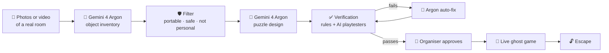

# 👻 Roomgeist

**Same room. Two realities. One escape.**

Roomgeist turns any ordinary room into a Halloween escape game. You don't hide a single prop. Gemini reads the real room and imagines a haunted twin of it, where the clues live. A live AI ghost watches the real room through a webcam, where the answers live. To escape, players have to connect the two worlds.

> Built in one day at the **Halloween Hackathon with Google DeepMind** at Imperial College London (31 October 2026), Track 2: Multimodal & Human-Centric AI.

---

## Table of contents

- [The problem](#the-problem)
- [Two superpowers](#two-superpowers)
- [How it works](#how-it-works)
- [Verification: we don't just hope it works](#verification-we-dont-just-hope-it-works)
- [The live ghost](#the-live-ghost)
- [Models used](#models-used)
- [Project structure](#project-structure)
- [API](#api)
- [Getting started](#getting-started)
- [Project status](#project-status)
- [Roadmap](#roadmap)

---

## The problem

Alex runs events for an international student society. Tonight she's hosting Halloween for **20 freshers who have never met**, in a **borrowed lecture theatre**, and their levels of English are very different.

| Problem | Why normal options fail |
|---|---|
| **She can't touch the room** | No tape, no hidden props, no locks. The room must be returned exactly as she found it. |
| **She has no budget** | A commercial escape room costs over £20 a head, and it's across town. |
| **Party games leave people out** | Shy players and non-native speakers go quiet while a few loud people play. |

So our puzzles are **easy on purpose**. Alex doesn't need a game that beats people. She needs one that **everyone can solve, so everyone starts talking.**

---

## Two superpowers

| | 🔮 Superpower 1: **Imagine** | 👁️ Superpower 2: **Perceive** |
|---|---|---|
| **What** | A haunted twin of your room | A live ghost that sees the real room |
| **Models** | Gemini 4 Argon + Nano Banana 2.1 | Gemini 3.8 Live (camera + voice) |
| **Role** | Reads the room and reimagines it as a Gothic haunted world. **The clues live here.** | Watches players hold up real objects and talks back in real time. **The answers live here.** |

**Why virtual first, then real?**

- **No props, no setup.** The answers are things already in the room, so nothing has to be hidden.
- **The familiar becomes a mystery.** A red marker is just a marker until it becomes a *blood-stained quill*. Working out the link is the puzzle.
- **Strangers have to talk.** One person explores the haunted world while everyone else searches the real room.
- **Every find changes the world.** Each real object lifts a curse and reveals a digit of the escape code.

> *Virtual exploration reveals real-world clues. Real-world discovery changes the virtual world.*

---

## How it works



1. **Scan.** The organiser uploads a few photos (or one short video) of the room and fills in the event: players, teams, minutes and scare level.
2. **Understand.** Gemini 4 Argon lists every visible object, with its colour, its position relative to a landmark, a bounding box, and whether it is portable, safe and shared.
3. **Filter.** Personal belongings (bags, earbuds, someone's coffee), fixed equipment and unsafe items are excluded automatically. **We never ask players to touch other people's things.**
4. **Design.** Argon writes a ghost story and four riddles, each pointing to a different real object and each rewarding one digit of the door code.
5. **Verify.** The game is checked before anyone plays it (see below).
6. **Approve.** A human organiser presses *Approve*. Only then does the game start.
7. **Play.** The live ghost hosts the game, players hold up real objects to the webcam, and every correct find reveals a digit.

---

## Verification: we don't just hope it works

AI-generated games break. Roomgeist checks every game in two layers before a human approves it.

| Layer | How | Catches |
|---|---|---|
| **1. Rule check** | Deterministic code, no AI | The door code doesn't match the puzzle digits (**"UNESCAPABLE: this game can never be won"**), a target that isn't in the room, an object used twice, a clue that gives away the answer |
| **2. AI playtesters** | 3 × Gemini 3.8 Flash, run in parallel. Each sees **only the clue and the object list, never the answer** | Ambiguous clues (players pick different objects) and clues that are too hard |
| **Auto-fix** | Gemini 4 Argon rewrites only what failed, then everything is re-checked (max 3 rounds) | |
| **Human approval** | The organiser approves the final game | |

The three playtester personas make sure every clue works for everyone in the room:

- 😴 **Tired student**: reads quickly and takes clues literally
- 🌍 **Non-native speaker**: may miss idioms and wordplay
- 🧒 **10-year-old**: knows simple words and obvious colours and shapes

A planted **broken demo level** (`GET /api/broken-game`) shows the whole loop. It has an ambiguous "something red as blood" clue in a room with two red objects, plus a door code that can never be reached. Both problems are caught, fixed and re-verified.

---

## The live ghost

The ghost is a **Gemini 3.8 Live** session running in the browser with the microphone and webcam (1 frame per second).

**The ghost never decides whether an answer is right.** It sees the list of objects in the room but not which one is the answer. When a player holds something up, it only reports what it sees by calling a tool. Our deterministic game code decides, then tells the ghost what to say next. This means the ghost can't be talked into letting players win, and it can't leak the solution.

| Tool | Called when | Decided by |
|---|---|---|
| `confirm_object_shown(object_id)` | A player holds an object up to the camera | `gameState.ts` |
| `check_code(code)` | Players speak the door code | `gameState.ts` |
| `request_hint()` | Players ask for help or seem stuck | `gameState.ts` (two-level hint ladder) |

If the camera misreads an object, an **organiser override** lets a human confirm it manually, so a human always stays in control.

---

## Models used

| Job | Model |
|---|---|
| Room understanding, puzzle design, auto-fix | `gemini-4-argon` (`thinking_level` medium / high) |
| AI playtesters | `gemini-3.8-flash` |
| Live ghost host (voice + camera + tool calls) | `gemini-3.8-live` |
| Haunted version of the room | `gemini-nano-banana-2.1` |

---

## Project structure

```
.
├── server.ts                 # Express server + API routes (Gemini is called server-side)
├── gameGenerator.ts          # Stage 1: room → objects → filter → puzzles → rule check
├── verifier.ts               # Stage 2: AI playtesters + Argon auto-fix loop + broken demo level
├── gameState.ts              # Deterministic game state machine (right/wrong, hints, door code)
├── ghostLive.ts              # Stage 4: Gemini Live session (mic, webcam, voice, tool calls)
├── GhostPanel.tsx            # Webcam, ghost captions, code digits, organiser override
└── src/
    ├── App.tsx               # Page flow and shared game state
    ├── components/
    │   ├── VerificationScreen.tsx   # Checklist, playtester cards, fix history, approve button
    │   └── RoomScene.tsx            # Haunted room scene, synced to the game state
    └── utils/
        └── escapeData.ts     # Shared types, sample room data, demo data
```

---

## API

| Method | Route | Description |
|---|---|---|
| `POST` | `/api/generate-game` | Body: `{ media: [{ mimeType, base64 }], event, approvedIds?, mock? }`. Returns inventory, usable / rejected objects, game and rule check. |
| `POST` | `/api/verify` | Body: `{ game, usable_objects, mock? }`. Runs verification and auto-fix. Returns `{ final_game, passed, history }`. |
| `GET` | `/api/broken-game` | Returns the planted broken level for the demo. |
| `POST` | `/api/live-token` | Returns a short-lived token so the browser can open a Gemini Live session. **The API key never leaves the server.** |

Shared data format (field names are fixed across all modules):

```jsonc
{
  "usable_objects": [
    {
      "id": "red_whiteboard_marker",
      "name": "red marker pen",
      "color": "red and white",
      "location": "lying flat on the central AV podium",
      "portable": true, "camera_distinct": 4, "owner": "shared", "safe": true,
      "image_ref": { "photo_index": 5, "box_2d": [550, 565, 562, 630] }   // [ymin, xmin, ymax, xmax], 0-1000
    }
  ],
  "game": {
    "title": "The Phantom Lecture of Imperial Hall",
    "puzzles": [
      { "id": "p1", "clue": "I bleed crimson ink upon the great pale wall…", "solve_by": "show_object",
        "target": "red_whiteboard_marker", "reward_digit": "4", "hints": ["…", "…"] }
    ],
    "final_code": "4927"
  }
}
```

---

## Getting started

**Requirements:** Node.js 20+, a Gemini API key, and a browser with a webcam and microphone (Chrome recommended; the page must be served over `https` or `localhost`).

```bash
# 1. Install dependencies
npm install

# 2. Add your API key
echo 'GEMINI_API_KEY="your-key-here"' > .env

# 3. Start the server (Express + Vite on http://localhost:3000)
npx tsx server.ts
```

> If you run the project in **Google AI Studio Build**, set `GEMINI_API_KEY` in the **Secrets** panel instead of a `.env` file. Never commit your key.

### Try it without an API key

Turn on **Demo mode (offline)** in the app. Generation and verification then use built-in sample data, so you can walk through the whole flow, including the broken demo level.

You can also test the core logic from the command line:

```bash
npx tsx gameGenerator.ts --mock   # inventory filter + rule check
npx tsx verifier.ts --mock        # broken level → caught → fixed → passed
npx tsx gameState.ts --test       # wrong object → hint → 4 puzzles → wrong code → escape
```

---

## Project status

Built in one day, so here is an honest snapshot.

| ✅ Working | 🚧 In progress |
|---|---|
| Room understanding and object filtering | Fully explorable 3D haunted world (WASD movement) |
| Puzzle generation with rule check | A cursed counterpart for every real object (e.g. marker → quill) |
| AI playtesters + Argon auto-fix + organiser approval | "Lift the curse" animations synced to real-world finds |
| Deterministic game state machine | End-to-end testing of Live audio/video on deployed builds |
| Live ghost with tool calls and organiser override | |
| Offline demo mode and broken demo level | |

---

## Roadmap

- **Investigate the haunted world:** players walk to the altar and open a spellbook to reveal the riddle, so the 3D space becomes part of the puzzle, not just the backdrop.
- **Every find changes the world:** hidden doors open and runes light up, unlocking the next area.
- **More themes:** Gothic manor, abandoned asylum, and a kid-friendly pumpkin cottage.
- **More puzzle types:** colour sequences, counting, and teamwork puzzles where two players must share what they see.
- **An offline designer model:** every level that passes verification becomes training data for a small **Gemma** model that designs escape rooms on-device, so room photos never need to leave the phone.

---

## Team

Built by **team Roomgeist** at the Halloween Hackathon with Google DeepMind, Imperial College London.

<!-- Add team member names and GitHub handles here -->

*Happy Halloween. 🎃*
