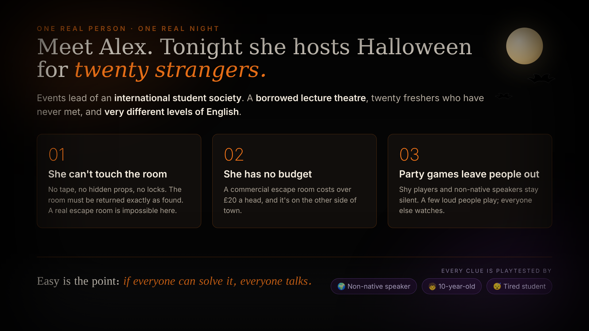
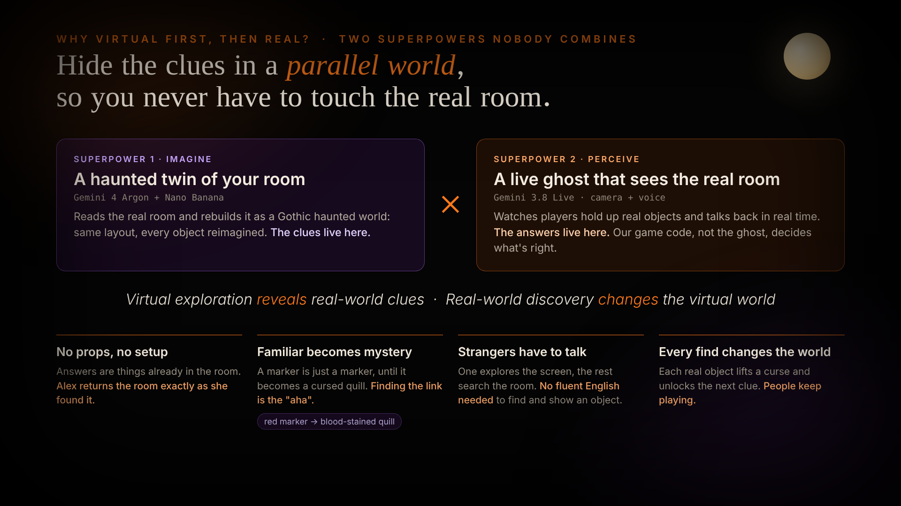
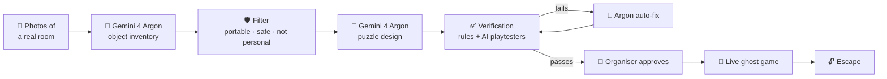

<div align="center">

# 👻 Roomgeist

**Same room. Two realities. One escape.**

Turn any ordinary room into a Halloween escape game, with no props and no setup.

<br/>

<a href="https://ai.studio/apps/adbd89f1-cf72-4101-b836-68a29c6cba52">
  
</a>

<br/><br/>

**👉 Live demo: https://ai.studio/apps/adbd89f1-cf72-4101-b836-68a29c6cba52**

*Runs in the browser. Use Chrome and allow camera and microphone access.*

🎬 **New here? [Watch the walkthrough video](guidance.mp4)** first to see how a game plays.

<br/>

Built in one day at the **Halloween Hackathon with Google DeepMind**, Imperial College London (31 October 2026).<br/>
Track 2: Multimodal & Human-Centric AI.

</div>

---

## 🎃 For judges: try it in 3 minutes

0. *(Optional)* **[Watch the walkthrough video](guidance.mp4)** to see the full flow.
1. **Open the [live demo](https://ai.studio/apps/adbd89f1-cf72-4101-b836-68a29c6cba52)** in Chrome and allow camera and microphone access.
2. **Scan a room.** Upload a few photos of the room you're in, or pick one of the built-in sample rooms.
3. **Watch the verification step.** Rule checks and three AI playtesters test every clue before the game is allowed to start. Load the **broken demo level** to see a broken game get caught, auto-fixed and re-checked.
4. **Approve and play.** Read a riddle in the haunted room, find the matching object in your real room, and hold it up to the webcam. The ghost reacts, and a digit of the door code appears.
5. **Escape.** Say the four-digit code out loud to the ghost.

> No API key needed to try it: the live demo above is already set up. If the camera misreads an object, use the **organiser override** to confirm it by hand.

---

## Contents

- [The problem](#the-problem)
- [Two superpowers](#two-superpowers)
- [How it works](#how-it-works)
- [Verification: we don't just hope it works](#verification-we-dont-just-hope-it-works)
- [The live ghost](#the-live-ghost)
- [Models used](#models-used)
- [Project structure](#project-structure)
- [API](#api)
- [Run it locally](#run-it-locally)
- [Project status](#project-status)
- [Roadmap](#roadmap)

---

## The problem



Alex runs events for an international student society. Tonight she's hosting Halloween for **20 freshers who have never met**, in a **borrowed lecture theatre**, and their levels of English are very different.

| Problem | Why the usual options fail |
|---|---|
| **She can't change the room** | No tape, no hidden props, no locks. The room has to be returned exactly as she found it. |
| **She has no budget** | A commercial escape room costs over £20 a head, and it's across town. |
| **Party games leave people out** | Shy players and non-native speakers go quiet while a few loud people take over. |

So our puzzles are **easy on purpose**. Alex doesn't need a game that beats people. She needs one that **everyone can solve, so that everyone starts talking.**

---

## Two superpowers



| | 🔮 **Imagine** | 👁️ **Perceive** |
|---|---|---|
| **What** | A haunted twin of your room | A live ghost that sees the real room |
| **Models** | Gemini 4 Argon + Nano Banana 2.1 | Gemini 3.8 Live (camera + voice) |
| **Role** | Reads the room and reimagines it as a Gothic haunted world. **The clues live here.** | Watches players hold up real objects and talks back in real time. **The answers live here.** |

**Why imagine first, then perceive?**

- **No props, no setup.** The answers are things already in the room, so nothing has to be hidden.
- **The familiar becomes a mystery.** A red marker is just a marker until it becomes a *blood-stained quill*. Working out the link is the puzzle.
- **Strangers have to talk.** One person explores the haunted world while everyone else searches the real room.
- **Every find changes the game.** Each real object lifts a curse and reveals a digit of the escape code.

> *The haunted room gives you the clues. The real room holds the answers.*

---

## How it works



1. **Scan.** The organiser uploads a few photos of the room and sets up the event: number of players, teams, time limit and scare level.
2. **Understand.** Gemini 4 Argon lists every visible object with its colour, its position next to a landmark, a bounding box, and whether it is portable, safe and shared.
3. **Filter.** Personal belongings (bags, earbuds, someone's coffee), fixed equipment and unsafe items are left out automatically. **Players are never asked to touch other people's things.**
4. **Design.** Argon writes a ghost story and four riddles. Each riddle points to a different real object and unlocks one digit of the door code.
5. **Verify.** The game is tested before anyone plays it (see below).
6. **Approve.** A human organiser presses *Approve*. Only then does the game start.
7. **Play.** The live ghost hosts the game. Players hold real objects up to the webcam, and every correct find reveals a digit.

---

## Verification: we don't just hope it works

AI-generated games break. Roomgeist tests every game in two layers before a human approves it.

| Layer | How | What it catches |
|---|---|---|
| **1. Rule check** | Plain code, no AI | A door code that doesn't match the puzzle digits (**"UNESCAPABLE: this game can never be won"**), a target that isn't in the room, an object used twice, a clue that gives the answer away |
| **2. AI playtesters** | 3 × Gemini 3.8 Flash in parallel. Each one sees **only the clue and the object list, never the answer** | Ambiguous clues (playtesters pick different objects) and clues that are too hard |
| **Auto-fix** | Gemini 4 Argon rewrites only the parts that failed, then everything is tested again (up to 3 rounds) | |
| **Human approval** | The organiser approves the final game | |

The three playtester personas make sure every clue works for everyone in the room:

- 😴 **Tired student**: reads quickly and takes clues literally
- 🌍 **Non-native speaker**: may miss idioms and wordplay
- 🧒 **10-year-old**: knows simple words and obvious colours and shapes

A planted **broken demo level** (`GET /api/broken-game`) shows the whole loop. Its clue "something red as blood" fits two red objects in the room, and its door code can never be reached. Both problems are caught, fixed and checked again.

---

## The live ghost

The ghost is a **Gemini 3.8 Live** session that runs in the browser and uses the microphone and webcam (1 frame per second).

**The ghost never decides whether an answer is right.** It knows which objects are in the room, but not which one is the answer. When a player holds something up, the ghost only reports what it sees by calling a tool. Our own game code makes the decision and tells the ghost what to say next. So nobody can talk the ghost into letting them win, and the ghost can't give away the solution.

| Tool | Called when | Decided by |
|---|---|---|
| `confirm_object_shown(object_id)` | A player holds an object up to the camera | `src/gameState.ts` |
| `check_code(code)` | Players say the door code | `src/gameState.ts` |
| `request_hint()` | Players ask for help or seem stuck | `src/gameState.ts` (two-step hints) |

If the camera misreads an object, the **organiser override** lets a person confirm it by hand, so a human always stays in control.

---

## Models used

| Job | Model |
|---|---|
| Room understanding, puzzle design, auto-fix | `gemini-4-argon` (`thinking_level` medium / high) |
| AI playtesters | `gemini-3.8-flash` |
| Live ghost host (voice + camera + tool calls) | `gemini-3.8-live` |
| Haunted version of the room | `gemini-nano-banana-2.1` |

---

## Project structure

```
.
├── server.ts                  # Express server and API routes (all Gemini calls run on the server)
├── gameGenerator.ts           # Room → objects → filter → puzzles → rule check
├── verifier.ts                # AI playtesters, Argon auto-fix loop, broken demo level
└── src/
    ├── App.tsx                # Page flow and shared game state
    ├── gameState.ts           # Game logic: right/wrong answers, hints, door code
    ├── ghostLive.ts           # Gemini Live session (mic, webcam, voice, tool calls)
    ├── GhostPanel.tsx         # Webcam, ghost captions, code digits, organiser override
    ├── components/
    │   ├── VerificationScreen.tsx   # Checklist, playtester cards, fix history, Approve button
    │   ├── RoomScene.tsx            # Haunted room scene, kept in sync with the game state
    │   ├── ThreeViewport.tsx        # 3D view of the haunted room
    │   ├── UploadModal.tsx          # Room photo upload
    │   └── CameraVerifyModal.tsx    # Webcam check for real-world objects
    ├── hooks/
    │   └── useEscapeGameState.ts
    └── utils/
        ├── escapeData.ts      # Shared types, sample room data, demo data
        └── sampleRooms.ts     # Built-in sample rooms
```

---

## API

| Method | Route | Description |
|---|---|---|
| `POST` | `/api/analyze-room` | Body: `{ images: [{ imageBase64, mimeType }] }`. Analyses room photos and returns the objects and layout used to build the haunted room. |
| `POST` | `/api/generate-game` | Body: `{ media: [{ mimeType, base64 }], event, approvedIds?, mock? }`. Returns the inventory, usable and rejected objects, the game and the rule check. |
| `POST` | `/api/verify` | Body: `{ game, usable_objects, mock? }`. Runs verification and auto-fix. Returns `{ final_game, passed, history }`. |
| `POST` | `/api/verify-object` | Body: `{ imageBase64, mimeType, expectedObject, puzzleClue }`. Checks a webcam frame against the expected object. |
| `GET` | `/api/broken-game` | Returns the planted broken level for the demo. |
| `POST` | `/api/live-token` | Returns a short-lived token so the browser can open a Gemini Live session. **The API key never leaves the server.** |

Shared data format (field names are the same in every module):

```jsonc
{
  "usable_objects": [
    {
      "id": "red_whiteboard_marker",
      "name": "red marker pen",
      "color": "red and white",
      "location": "lying flat on the central AV podium",
      "portable": true, "camera_distinct": 4, "owner": "shared", "safe": true,
      "image_ref": { "photo_index": 5, "box_2d": [550, 565, 562, 630] }   // [ymin, xmin, ymax, xmax], 0-1000
    }
  ],
  "game": {
    "title": "The Phantom Lecture of Imperial Hall",
    "puzzles": [
      { "id": "p1", "clue": "I bleed crimson ink upon the great pale wall…", "solve_by": "show_object",
        "target": "red_whiteboard_marker", "reward_digit": "4", "hints": ["…", "…"] }
    ],
    "final_code": "4927"
  }
}
```

---

## Run it locally

You don't need to do this to judge the project: the [live demo](https://ai.studio/apps/adbd89f1-cf72-4101-b836-68a29c6cba52) is the easiest way to try it.

**Requirements:** Node.js 20+, a Gemini API key, and Chrome with a webcam and microphone. The page must be served over `https` or from `localhost`.

```bash
# 1. Install dependencies
npm install

# 2. Add your API key (see .env.example)
echo 'GEMINI_API_KEY="your-key-here"' > .env

# 3. Start the server (Express + Vite on http://localhost:3000)
npm run dev
```

> In **Google AI Studio Build**, set `GEMINI_API_KEY` in the **Secrets** panel instead of a `.env` file. Never commit your key.

`/api/generate-game` and `/api/verify` also accept `"mock": true`, which uses built-in sample data instead of calling Gemini.

---

## Project status

Built in one day, so here is an honest snapshot.

| ✅ Working | 🚧 In progress |
|---|---|
| Room understanding and object filtering | A fully explorable 3D haunted world |
| Puzzle generation with rule check | A cursed counterpart for every real object (e.g. marker → quill) |
| AI playtesters, Argon auto-fix and organiser approval | "Lift the curse" animations synced to real-world finds |
| Game logic that decides every answer | Full testing of live audio and video on deployed builds |
| Live ghost with tool calls and organiser override | |
| Broken demo level | |

---

## Roadmap

- **Explore the haunted world:** players walk to the altar and open a spellbook to read the riddle, so the 3D space becomes part of the puzzle, not just the background.
- **Every find changes the world:** hidden doors open and runes light up, unlocking the next area.
- **More themes:** Gothic manor, abandoned asylum, and a kid-friendly pumpkin cottage.
- **More puzzle types:** colour sequences, counting, and teamwork puzzles where two players have to share what they see.
- **An on-device designer:** every level that passes verification becomes training data for a small **Gemma** model that designs escape rooms on the phone, so room photos never have to leave the device.

---

<div align="center">

### 👻 Ready to escape?

**[▶ Play Roomgeist](https://ai.studio/apps/adbd89f1-cf72-4101-b836-68a29c6cba52)**

Built by **team Roomgeist** at the Halloween Hackathon with Google DeepMind, Imperial College London.

<!-- Add team member names and GitHub handles here -->

*Happy Halloween. 🎃*

</div>
